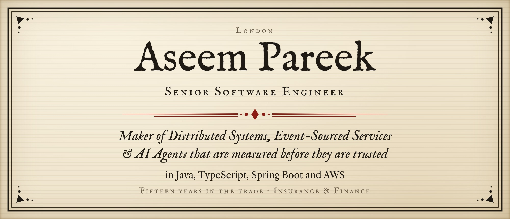
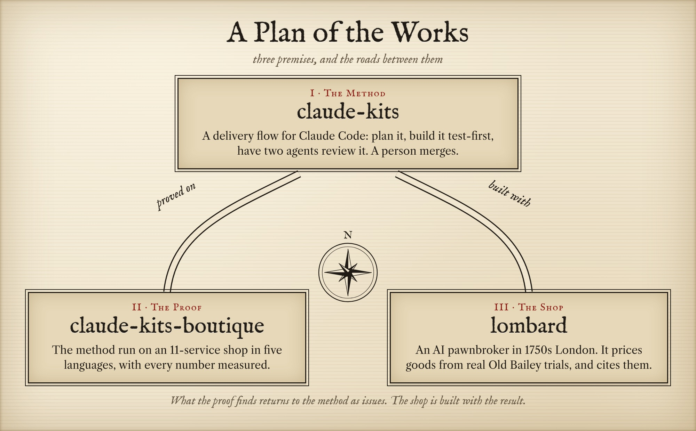

  

I'm a senior software engineer in London. For 15 years I've built distributed and event-sourced systems in Java,
TypeScript, Spring Boot and AWS, mostly for insurance and finance.

Now I work on AI engineering. I want coding agents to deliver software in small, reviewed steps, and I want AI
systems whose answers can be checked. The three projects below are one piece of work.

## The Works

  

### I. [claude-kits](https://github.com/myhts/claude-kits), the method

- **What it is:** a delivery flow for Claude Code that works on any stack. You plan a feature, Claude builds it
  test-first, two reviewer agents check it, and you review and merge.
- **What it delivers:** one ticket becomes one pull request of about 400 lines. Claude can't merge: a hook blocks
  merges and pushes to `main`. One reviewer knows the project and the other reads only the code, and in blind-graded
  tests each caught defects the other missed.
- **What's coming:** fixes to project set-up for repositories with several languages and matrix CI, found by running
  it on the boutique.

### II. [claude-kits-boutique](https://github.com/myhts/claude-kits-boutique), the proof

- **What it is:** Google's Online Boutique sample, 11 services in 5 languages, used to test claude-kits on a real
  application, one stage at a time. It isn't affiliated with Google.
- **What it delivers:** a record with every number measured. One command read all 11 services and found bugs nobody
  asked it to find, then made each one happen. Among them: an order that ships for $0.00, a cart that loses an item
  when two are added at once, an order charged twice, and a card number written to a log. Both runs cost $20.63 at
  list price. There's a [live explorer](https://myhts.github.io/claude-kits-boutique/explorer/explorer.html).
- **What's coming:** stage 4, features built end to end.
  - **The fixes** for the bugs it found, each one planned, built test-first and reviewed.
  - **A flash sale:** limited stock, a rush of buyers, and no unit sold twice. It's built in levels. Little's law
    (requests in the system = arrival rate × time each one takes) says where a level runs out: one stock row locked
    for 20 ms tops out near 50 reservations a second. The next level is built only when a load test shows the last
    one failing: first a row per unit claimed with `SKIP LOCKED`, or Redis, then a waiting room.
  - **Two of the bugs are rehearsals for it.** The lost cart item is the same read-then-write race that causes
    overselling, and the double charge is the idempotency problem the sale's payment step has.
  - **After that:** the reviewers tested on planted defects, a deploy with rollout and undo, and a retro on what it
    cost.

### III. [lombard](https://github.com/myhts/lombard), the shop

- **What it is:** a game where you try to con an AI pawnbroker in 1750s London. It prices goods from real Old Bailey
  trials and cites each one, lends within limits set in code, and watches for stolen goods.
- **What it delivers:** a worked answer to the problems that keep AI agents out of real work. Made-up facts, prompt
  injection, leaked data, unsafe actions and surprise bills each get a control outside the model and an eval that
  proves it. Its [README](https://github.com/myhts/lombard#what-the-shop-is-really-for) lists all ten. It's early: the
  walking skeleton is being built now.
- **What's coming:** the archive and measured search, the pawnbroker's tool loop, AI customers who try to con it,
  then a deployed shop for invited players. The [road map](https://github.com/myhts/lombard#the-road-to-opening-day)
  has every stop.

## An Almanack of What Is Coming

| | Now | Next | After that |
|---|---|---|---|
| **claude-kits** | Fixing what the boutique found in project set-up | The build and review steps, proved on the boutique | The deploy step, proved on the boutique |
| **claude-kits-boutique** | Stages 1 to 3 done: the readers, the architecture, the set-up | Stage 4: the fixes, then a flash sale built in levels | The reviewers, shipping, the retro |
| **lombard** | The walking skeleton, and the interface as a kit | The explainable version: seven slices, each with a number | The deployed shop, and first players |

## The Trade

- **Languages and frameworks:** Java, TypeScript, Spring Boot
- **Systems:** event sourcing, distributed systems, AWS
- **AI engineering:** coding agents, reviewer agents, retrieval, evals
- **Sectors:** Insurtech, Fintech

## Call at the Shop

Try [claude-kits](https://github.com/myhts/claude-kits) on a repository of your own and tell me where it breaks: an
[issue](https://github.com/myhts/claude-kits/issues) is the best way to reach me. Lombard will open to invited
players once it's deployed.
